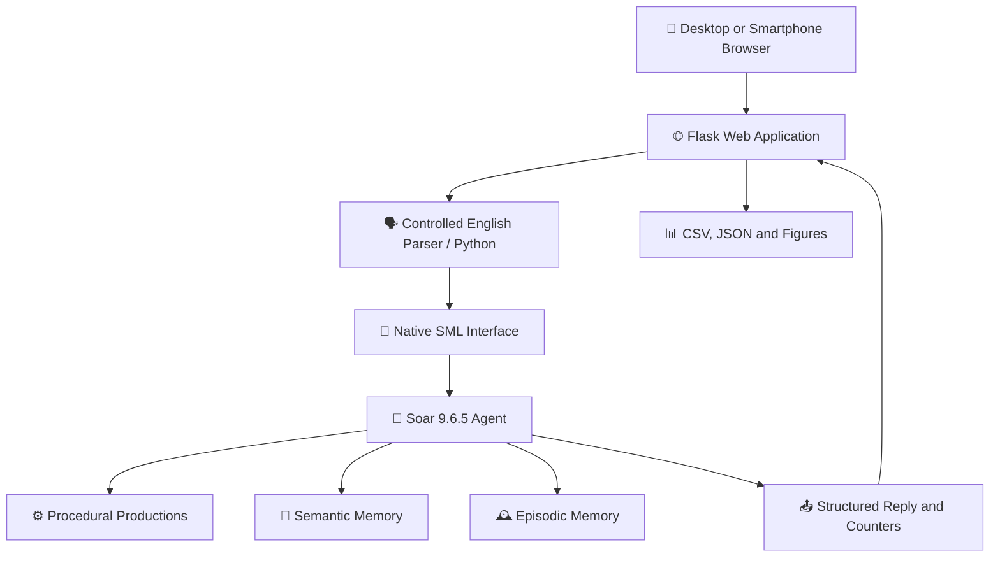

<div align="center">

# 🧠 SoarLab Chat

### A Web-Based Laboratory for Cognitive Memory in Educational Robotics

**Explore procedural rules, semantic knowledge, and episodic experiences through a native Soar cognitive agent.**

[](https://www.python.org/)
[](https://flask.palletsprojects.com/)
[](https://soar.eecs.umich.edu/)
[](#responsive-interface)
[](#automated-testing-and-benchmarks)

[🚀 Quick Start](#quick-start) · [💬 Example Questions](#example-questions) · [📈 Experiments](#automated-testing-and-benchmarks) · [📁 Source Code](SoarLab_Chat/)

</div>

---

## 🎯 Overview

**SoarLab Chat** is an educational and experimental platform for studying cognitive memory mechanisms in the **Soar 9.6.5** architecture. It provides a responsive web chatbot built with **Flask** and Python, allowing students to explore how a cognitive agent applies rules, retrieves facts, and recalls previous experiences.

The application uses the native **`soar-sml`** Python interface. **Soar performs the cognitive operations**; Python maps supported English questions and controlled paraphrases to structured requests and displays the returned answers. This is **not** an LLM-based chatbot, and its language interpretation should not be confused with Soar's native memory retrieval.

### ✨ Highlights

- 🧠 **Three native memory mechanisms** — procedural productions, semantic memory (SMem), and episodic memory (EpMem).
- 💬 **Guided conversation** — ask questions about sensors, robots, navigation, and cognitive architectures.
- 📚 **Seeded robotics knowledge** — explore a domain-specific corpus without creating all records manually.
- 🧩 **Controlled paraphrases** — use supported aliases and alternate question formulations.
- ✍️ **Teach new concepts** — add a semantic definition and verify native storage and retrieval.
- 🕘 **Record experiences** — create educational events for subsequent episodic recall.
- 📱 **Responsive interface** — use the same application from a desktop browser or smartphone.
- 🔬 **Automated experiments** — export individual measurements, summary tables, and eight figures.

## 📱 Responsive Interface

<div align="center">
  
  <p><em>Mobile interface showing a semantic-memory answer about the NAO robot and its provenance.</em></p>
</div>

The interface adapts to desktop and smartphone layouts. For smartphone access, the phone and host computer must be connected to the same trusted local network.

## 🧠 Cognitive Memories

| Memory | Initial educational records | Native Soar mechanism | Student activity |
|---|---:|---|---|
| ⚙️ **Procedural** | 108 domain-specific rules | Production rules (`sp`) | Explore rule-based responses to situations |
| 📘 **Semantic** | 124 robotics concepts | Semantic memory (SMem) | Retrieve definitions and teach new concepts |
| 🕰️ **Episodic** | 120 synthetic experiences | Episodic memory (EpMem) | Recall previously encoded educational events |
| **Total** | **352** | | |

The agent also contains infrastructure productions required for communication. The seeded episodic events are **synthetic classroom examples**, not records collected from physical robot missions. Each memory mechanism uses a different representation and retrieval process.

## 🏗️ Architecture



**Interpretation boundary:** Python recognizes the supported question form and prepares the request. The native Soar agent executes the associated production or memory operation. Controlled paraphrase recognition is provided by the Python layer, **not** by a general-purpose language model inside Soar.

## 🚀 Quick Start

### ✅ Requirements

- Python 3.12 (the tested Windows environment)
- The native **Soar 9.6.5** bindings, installed through `soar-sml==9.6.5`
- Flask and Matplotlib (listed in `requirements.txt`)
- A modern web browser

### 🪟 Windows (PowerShell)

Clone the repository and open the application directory:

```powershell
git clone https://github.com/vitor-souza-ime/soarlab.git
cd soarlab\SoarLab_Chat
```

Install dependencies and check the native binding:

```powershell
python -m pip install -r requirements.txt
python -c "import soar_sml; print(soar_sml.__file__)"
```

Run the native diagnostic and launch Flask:

```powershell
python soar_diagnosis.py
python app.py
```

Open **http://127.0.0.1:5000** in your browser. The startup process verifies seeded semantic and episodic information; initialization can take longer than a typical Flask application. Cognitive requests do not fall back to mock data if native Soar is unavailable.

### 🐧 Linux / 🍎 macOS

If a compatible native `soar-sml` installation is available for your platform:

```bash
git clone https://github.com/vitor-souza-ime/soarlab.git
cd soarlab/SoarLab_Chat
python -m pip install -r requirements.txt
python soar_diagnosis.py
python app.py
```

Native binding availability and platform-specific dependencies must be verified locally.

### 📲 Access from a Smartphone

On the host computer:

```powershell
python app.py --lan
```

Use `ipconfig` (Windows) to find the computer's local IPv4 address, then open `http://YOUR_PC_IP:5000` on a phone connected to the same Wi-Fi network.

> 🔐 **Security note:** LAN mode does not provide authentication. Use a trusted network and **do not** expose the Flask development server directly to the internet.

## 💬 Example Questions

| Memory | Example question |
|---|---|
| 📘 Semantic | `What is the NAO robot?` |
| 📘 Semantic | `Explain SLAM.` |
| 📘 Semantic | `What is ROS 2?` |
| 📘 Semantic | `What is an occupancy grid?` |
| ⚙️ Procedural | `What should the robot do if the battery is low in a classroom demonstration?` |
| ⚙️ Procedural | `How should the robot react when an obstacle is close in a classroom demonstration?` |
| 🕰️ Episodic | `Do you remember an obstacle?` |
| 🕰️ Episodic | `What happened with the battery earlier?` |

See the [evaluation question set](SoarLab_Chat/EVALUATION_QUESTIONS.md) for additional supported prompts.

### ✍️ Teaching an Unknown Concept

1. Ask `What is a tactile sensor array?` — this concept is intentionally absent from the initial corpus.
2. Select **Teach a new concept**.
3. Enter the topic `Tactile sensor array` and a definition, such as `A tactile sensor array measures contact forces at multiple points on a robot's surface.`
4. Optionally register aliases (for example, `tactile matrix`).
5. Submit the information and repeat the question or use `Explain the tactile matrix.`

A successful teaching notification is issued only after the application verifies **native SMem storage followed by retrieval**. Learned concepts and experiences are additionally journaled for restoration when the application restarts; those files do **not** replace the native Soar memory mechanisms.

## 🔬 Automated Testing and Benchmarks

Tests execute against the native Soar agent. You do not need to ask each question manually.

From `SoarLab_Chat/`:

```powershell
# Quick validation: 352 memory checks + 48 measured questions
python run_all_tests.py --quick

# Full experiment: 48 questions × 15 repetitions × 5 independent runs
python run_all_tests.py --full

# Custom experiment
python run_all_tests.py --seeds 2026,2027,2028 --repetitions 5
```

The full configuration schedules **3,600 measured queries**, with an excluded warm-up block for each run. All seed values and configuration details are exported for reproducibility. Actual completed counts and errors must be checked in the generated manifest before reporting results.

### 📈 Measurements and Figures

The benchmark exports raw CSV data, metadata, native-memory audit outcomes, and eight plots:

| Figure | Measurement |
|---|---|
| 01 | Latency distribution by memory type |
| 02 | Median latency and 95th percentile (P95) |
| 03 | Fixed-corpus correctness or session replay agreement |
| 04 | Latency across successive queries |
| 05 | Native semantic and episodic query-counter changes |
| 06 | Controlled paraphrase recognition results |
| 07 | Soar decision cycles per response |
| 08 | Application end-to-end vs. Soar/SML call latency |

Generated artifacts are stored under [`SoarLab_Chat/results/`](SoarLab_Chat/results/). They include files such as `native_memory_audit.csv`, `combined_raw.csv`, `summary_by_memory.csv`, `run_index.csv`, and `automation_manifest.json` when using the automated runner. A completed benchmark can be replotted without rerunning Soar:

```powershell
python regenerar_graficos.py
```

### 🧪 What Do the Graphs Represent?

- **Fixed evaluation corpus** uses 48 predefined English questions and controlled paraphrases, rather than arbitrary chat messages. This is the recommended regression benchmark for reproducible experiments.
- **Current chat questions** replays recent questions asked in the interface. Agreement with previous replies is **not independent accuracy**.
- Soar/SML timing includes orchestration through the client interface; it is **not** a pure low-level retrieval-time benchmark.
- End-to-end timing refers to the application processing path; browser/network transfer time is not measured as a separate component.

A perfect score on a fixed, supported question set should **not** be interpreted as open-domain language understanding or proof of student learning.

## 📂 Repository Layout

```text
soarlab/
├── README.md                    # Project overview
├── assets/
│   └── soarlab-mobile.png       # Smartphone interface screenshot
└── SoarLab_Chat/
    ├── app.py                   # Flask entry point
    ├── soar_diagnosis.py        # Native Soar diagnostic
    ├── run_all_tests.py         # Automated benchmarks
    ├── regenerar_graficos.py   # Plot regeneration
    ├── requirements.txt
    ├── agents/
    │   └── chat.soar            # Native Soar productions
    ├── data/                    # Seeded cognitive records
    ├── soarlab/                 # Cognitive integration and benchmark modules
    ├── static/                  # Front-end JavaScript and CSS
    ├── templates/               # Flask HTML templates
    ├── tests/                   # Software tests
    └── results/                 # Generated experimental artifacts
```

## 🎓 Educational and Research Use

SoarLab Chat is intended for introductory activities in **educational robotics, cognitive architectures, artificial intelligence, and experimental methods**. Students can compare procedural, semantic, and episodic mechanisms, inspect response provenance, and work with reproducible measurements.

For research reporting, distinguish **software verification** from **student learning outcomes**. The seeded episodic records are educational scenarios, and the built-in benchmark uses predefined prompts. A separate user study would be required to make claims about learning effectiveness or usability.

## 📚 Further Reading

- [Soar Cognitive Architecture](https://soar.eecs.umich.edu/)
- [Soar Semantic Memory Documentation](https://soar.eecs.umich.edu/soar_manual/06_SemanticMemory/)
- [Soar Episodic Memory Documentation](https://soar.eecs.umich.edu/soar_manual/07_EpisodicMemory/)
- J. E. Laird, *The Soar Cognitive Architecture*, MIT Press, 2012. [DOI: 10.7551/mitpress/7688.001.0001](https://doi.org/10.7551/mitpress/7688.001.0001)
- J. E. Laird, C. Lebiere, and P. S. Rosenbloom, "A Standard Model of the Mind," *AI Magazine*, 2017. [DOI: 10.1609/aimag.v38i4.2744](https://doi.org/10.1609/aimag.v38i4.2744)

---

<div align="center">

**🧠 SoarLab Chat — Making cognitive memory visible, teachable, and measurable.**

Developed for educational and experimental use in cognitive robotics.

[⬆ Back to Top](#soarlab-chat)

</div>
